<picture>
  <source media="(prefers-color-scheme: light)" srcset="./assets/header-light.svg">
  
</picture>

I'm Lolo. Most of my time goes into **A.C.C.E.S.S.**: a few AI agents that run
on my laptop, each with its own private memory, talking to each other
asynchronously. They can't do anything in the real world without my written OK.

Claude and Codex write most of the code, in parallel sessions, and a separate
review session has to approve before anything is merged. I decide what gets
built, what counts as done and what gets rejected. Every decision goes into a
dated file, word for word (50 as of October 2026).

### Things that went wrong

**Green tests, no wire.** Two agents disagreed 632 times. The arbitration
module ruled on every conflict and both test suites passed, but the ruling was
never written back where the agents read it. Since then a module only counts as
done once a real request has gone through it end to end.

**Guards that never failed.** In August an audit found that 58 of the repo's
158 guards had never been seen failing. A new guard now has to fail on purpose,
on broken code, before I rely on it.

**A green job that published nothing.** My profile workflow generated one file,
committed another and still reported success.
[Write-up](https://github.com/LoloMutekai/kairo-alcove/blob/main/notes/05-green-job.md).

Each bug gets a file in the repo: cause, fix, what to check first next time.
27 so far.

### Something you can run

The agents stay private. The [notebook](https://github.com/LoloMutekai/kairo-alcove)
has a small model of the parts I can share, standard library only:

```console
$ git clone https://github.com/LoloMutekai/kairo-alcove && cd kairo-alcove
$ python3 reference/check.py | grep -E 'reachable|"status"'
  "reachable_states": 40,
  "status": "PASS",
$ python3 reference/check.py --variant leaky > /dev/null; echo $?
1
```

The leaky variant is supposed to fail. If it ever passes, the checker is broken.
[The evidence note](https://github.com/LoloMutekai/kairo-alcove/blob/main/notes/04-evidence.md)
says where the model stops and the real system begins.

### Kairo

- **A.C.C.E.S.S.** — the agents. Private; [notebook](https://github.com/LoloMutekai/kairo-alcove) and [showcase](https://lolomutekai.github.io/kairo-alcove/).
- **[Sayna](https://www.sayna.app/)** — a patient app and dashboard for aesthetic clinics: bookings, loyalty, memberships.
- **Unicorn** — finding collaborators by what they've built rather than their title. In progress.
- **Maestrale** — a long-term military sim in Unreal Engine.
- **Tokonoma** — my Arch Linux desktop, and a 3D residence I'm building inside it.

### Before this

At 16, still in high school, I was discussing market regimes and order flow
with people running quant trading projects, and got invited into a quant
trading group.

<p align="center"><sub>床の間</sub></p>
